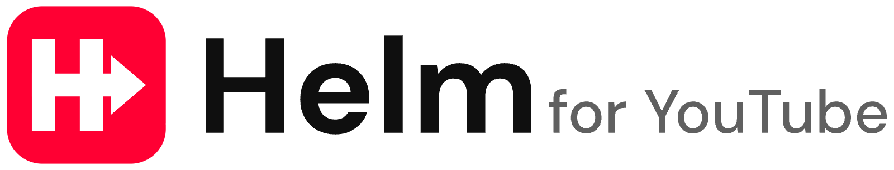
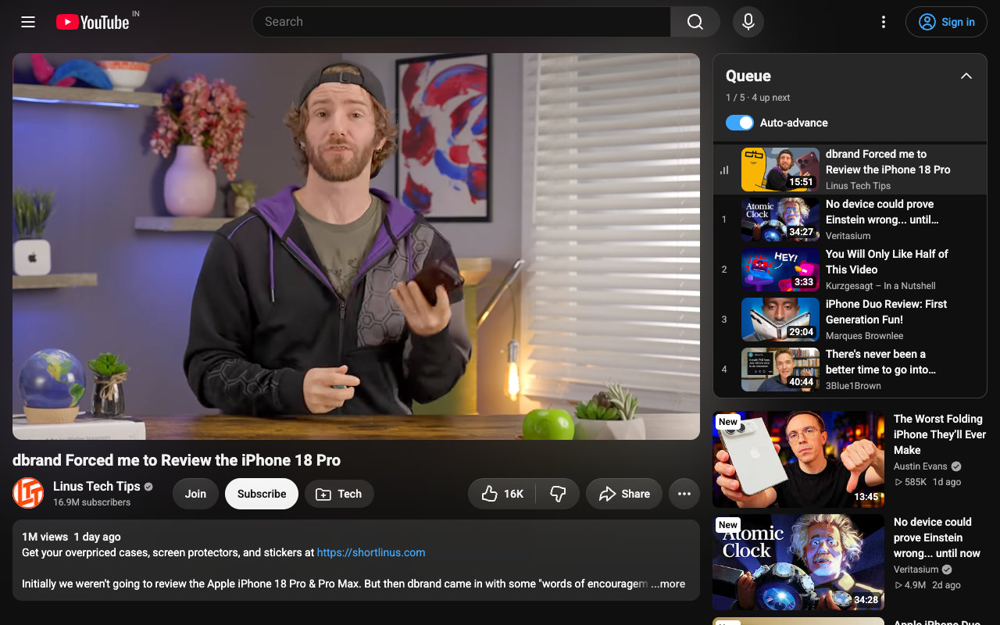
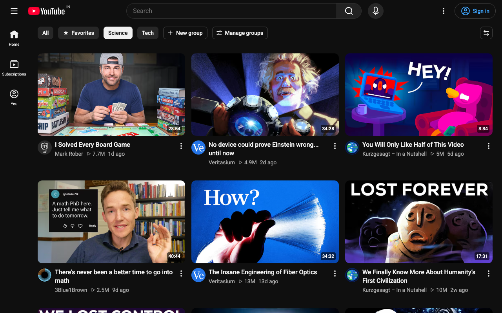
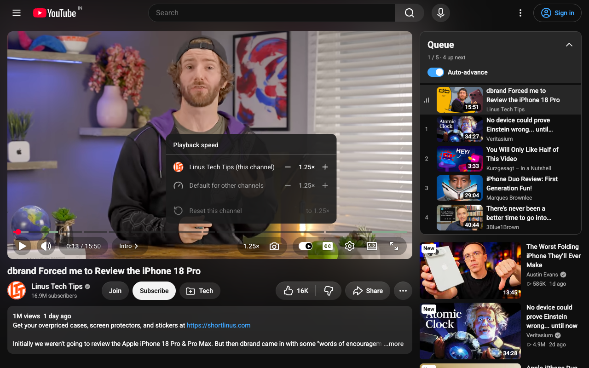
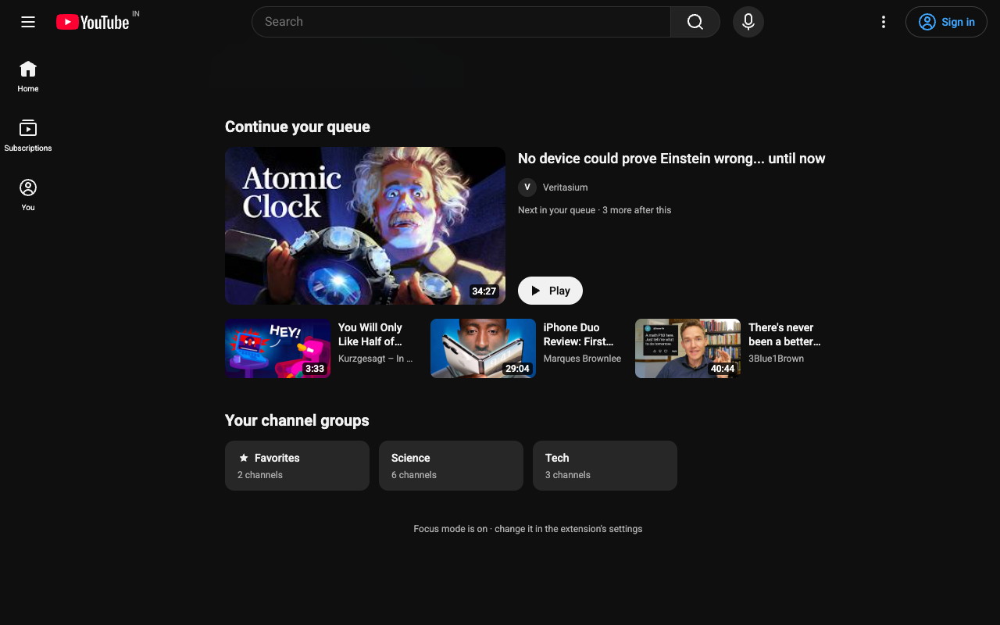

<h1 align="center">
  <picture>
    <source media="(prefers-color-scheme: dark)" srcset="branding/logo-dark.png">
    
  </picture>
</h1>

**Take the helm back from the algorithm.** Helm is a lightweight Chrome extension that removes YouTube's noise and adds the power-user features youtube.com is missing: a queue that works across tabs, channel groups, per-channel speed, sponsor skipping, notes and watch-time stats.

Manifest V3 · Chrome 126+ · No account · No tracking

<p align="center">
  
  
  
  
</p>

---

## Why Helm

- **Only what YouTube lacks.** Every feature passes one rule: youtube.com doesn't already do it.
- **Looks native.** Helm's controls sit in YouTube's own slots and use YouTube's own colors, so they match light and dark mode. No floating buttons, no extension branding on the page.
- **Stays fast.** Features you switch off run no code at all. The whole extension shares a single DOM observer.
- **Private by default.** No sign-in, no analytics. Your data stays in your browser.

## Features

Every feature can be switched on or off, and configured, from the toolbar popup. Everything is on from install except Focus mode, Feed filters, Grid density, Volume boost, Channel groups, Video notes and Theme.

### Clean up YouTube

| Feature | What it does |
|---|---|
| **Hide Shorts** | Removes Shorts from Home, search, the sidebar and channel pages. |
| **Hide Playables** | Removes Playables games from Home, the sidebar and feeds. |
| **Focus mode** | Hides the parts built to keep you scrolling: the Home feed, recommendations next to videos, comments, and view counts and dates. Each one is a separate option. |
| **Feed filters** | Hides videos by title keyword or by length, and hides videos you've already watched. |
| **Grid density** | Sets how many videos fit in a row on Home and YouTube's other video grids. |
| **Hide end-screen cards** | Removes the video tiles that cover the last seconds of a video. |

### Playback

| Feature | What it does |
|---|---|
| **Playback speed** | Starts every video at your speed and remembers a separate speed for each channel. A speed button in the player sets either one. |
| **Skip sponsors** | Auto-skips sponsor reads, self-promo and like/subscribe asks (intros and outros optional), using [SponsorBlock](https://sponsor.ajay.app). Segments show on the progress bar, and each skip has Undo. |
| **Volume boost** | Turns quiet videos up past 100%, to as much as 300%. |
| **Skip "Still watching?"** | Keeps playing without the pause prompt. |
| **A→B loop** | Loops one section of a video. |

### Your library

| Feature | What it does |
|---|---|
| **Queue** | One queue shared by every YouTube tab and window. It survives reloads and restarts, and shows as a panel next to the video. Add videos with YouTube's own "Add to queue", the button on a thumbnail's hover preview, or `Q`. It plays the next video automatically. |
| **Channel groups** | Groups your channels. Pick a group on Home or Subscriptions to see only its channels' latest videos, newest first. |
| **Video notes** | Keeps a private note on any video. Notes save automatically. |

### Watch time

| Feature | What it does |
|---|---|
| **Watch time** | Counts your watch time on this device: today, the last 7 days and your most-watched channels in the popup, and your total on each channel's page. A daily limit (2 h unless you change it) shows a reminder and never blocks anything. |

### Tools and appearance

| Feature | What it does |
|---|---|
| **Transcript download** | Saves a video's transcript as `.txt` or `.srt`, or copies it. |
| **Frame screenshot** | Saves the current frame as a PNG, with `S` or the camera button in the player. |
| **Theme** | Recolors YouTube with a preset palette, font and corner radius: Nord, Rosé, Forest, Solarized, Sepia, OLED Black or Terminal. |

### Keyboard shortcuts

Each works while its feature is on, and is ignored while you're typing in a text field.

| Key | Action |
|---|---|
| `Q` | Add the current video to the queue |
| `[` | Set the loop start |
| `]` | Set the loop end |
| `\` | Clear the loop |
| `S` | Save the current frame as a PNG |

### In the popup

- **Now playing:** the video in your queue's player tab (or another YouTube tab), with play/pause, 10-second skips, seeking, speed, previous/next and a jump to the tab. Another YouTube tab that's playing shows below it.
- **Queue:** reorder by dragging or with the arrow keys, play a video now or next, or remove it.
- **Watch time:** today's total in the header; open it for the last 7 days, your most-watched channels and the daily limit.
- **Theme:** switch themes from the header.
- **Settings:** every feature and its options, a master switch that pauses Helm, and backup and restore of all your settings and data as a JSON file.

## Install

**Chrome Web Store:** coming soon.
<!-- TODO: add the Chrome Web Store link once the listing is live. -->

**From source** (needs Node.js):

```bash
git clone https://github.com/thoughtlessmind/helm-youtube.git
cd helm-youtube
npm install
npm run build
```

Then open `chrome://extensions`, turn on **Developer mode**, click **Load unpacked**, and select `.output/chrome-mv3/`.

## Privacy and permissions

Helm has no account, no server and no analytics. Full policy: [PRIVACY.md](./PRIVACY.md).

| Permission | Why |
|---|---|
| `storage` | Saves your settings (synced through your Chrome profile) and your data: the queue, notes, channel groups, per-channel speeds and watch time. This data stays on your device. |
| `www.youtube.com` | Runs Helm's features on YouTube pages, and loads video titles and your channel groups' latest videos from YouTube itself. |
| `sponsor.ajay.app` | Fetches sponsor segments from SponsorBlock while **Skip sponsors** is on (it is by default). Only the first 4 characters of a hash of the video ID are sent, never the ID itself. |

The popup also loads video thumbnails from YouTube's image server, `i.ytimg.com`. Helm is not an ad blocker or a downloader, and it doesn't change how YouTube serves video.

## Development

Built with [WXT](https://wxt.dev), [Svelte 5](https://svelte.dev) and TypeScript.

```bash
npm run dev            # dev build with hot reload, output in .output/chrome-mv3-dev/
npm run build          # production build (Chrome)
npm run zip            # build and zip for the Chrome Web Store
npm run check          # typecheck (TypeScript and Svelte) and theme contrast check
```

After you change the manifest or the service worker, reload the extension in `chrome://extensions`. After a content-script change, reload the YouTube tab.

### Project structure

```
src/
├── entrypoints/
│   ├── youtube.content.ts       # Content script: loads the enabled features
│   ├── youtube-main.content.ts  # Small page-world helper for the queue and channel groups
│   ├── background.ts            # Service worker
│   └── popup/                   # Toolbar popup (Svelte)
├── features/                # One module per feature, loaded only when enabled
└── lib/
    ├── features.ts          # Feature registry
    ├── settings.ts          # Feature flags and config
    ├── feature-catalog.ts   # What the popup's Settings page shows
    ├── queue.ts             # The shared queue
    ├── backup.ts            # Backup export and import
    └── yt/                  # Shared YouTube helpers: DOM observer, navigation, player, UI kit
```

Each feature is a module with a `setup(ctx)` that can return a teardown function. To add a feature, and for the performance rules every feature must follow, see [`CLAUDE.md`](./CLAUDE.md).

Brand assets (icon source, logos, Chrome Web Store promo tiles and screenshots) are in [`branding/`](./branding).

## Feedback

Found a bug or want a feature? Open an issue on [GitHub](https://github.com/thoughtlessmind/helm-youtube/issues). Pull requests aren't accepted.

## Credits

- Sponsor segments: [SponsorBlock](https://sponsor.ajay.app/) data, licensed under [CC BY-NC-SA 4.0](https://creativecommons.org/licenses/by-nc-sa/4.0/).
- Popup font: DM Sans, © The DM Sans Project Authors, [SIL Open Font License 1.1](https://openfontlicense.org).
- Some icons adapted from [Feather](https://feathericons.com) (MIT) and [Lucide](https://lucide.dev) (ISC).

## License

[MIT](./LICENSE)

## Disclaimer

Helm is an independent project. It is not affiliated with, endorsed by, or sponsored by YouTube or Google LLC. YouTube is a trademark of Google LLC.
